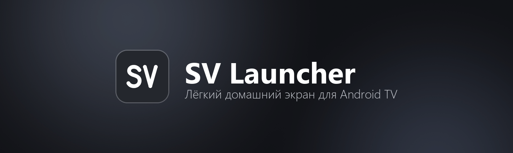
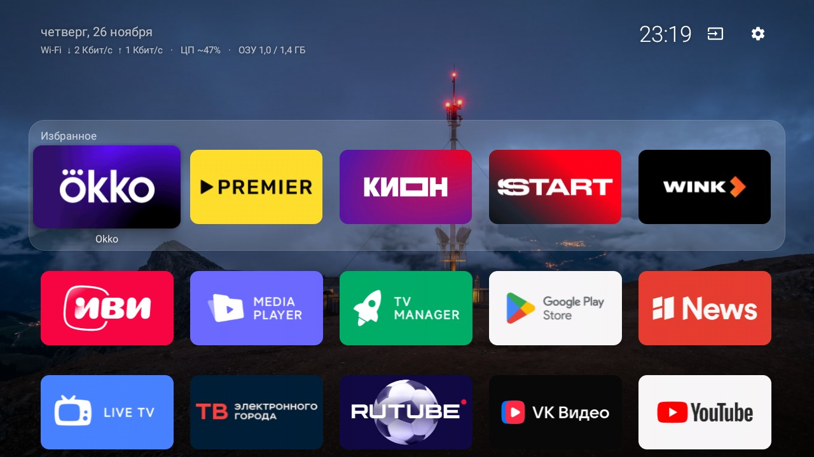
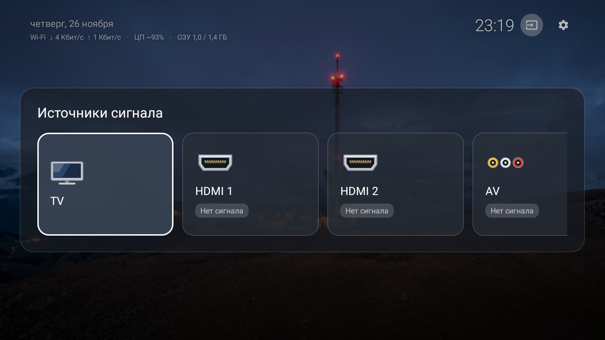
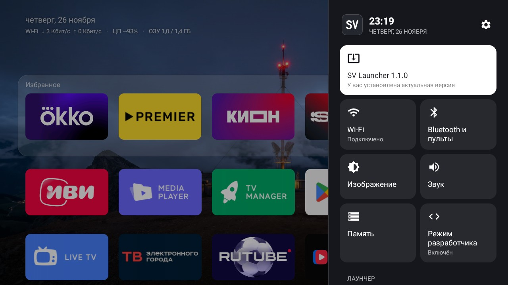
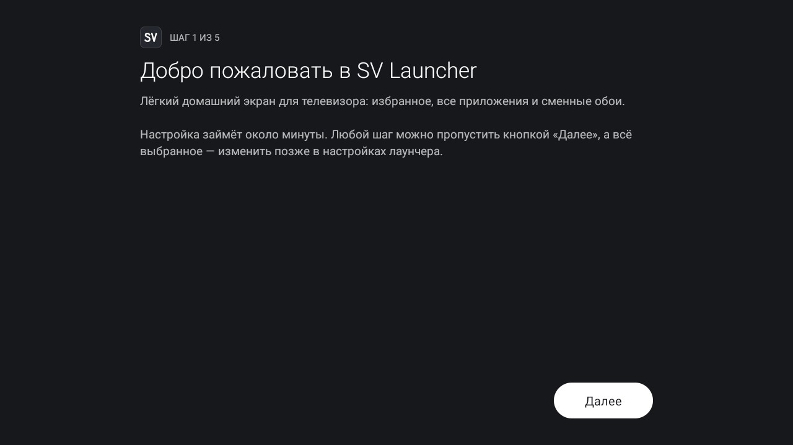

<div align="center">



[](https://github.com/Smrnw/SV_Launcher/releases/latest)
[](https://github.com/Smrnw/SV_Launcher/releases)


[](LICENSE)

**Лёгкий домашний экран для Android TV и Google TV.**

Избранное, все приложения и сменные обои — без рекламы, рекомендаций и лишних служб.<br>
Крупные карточки, плавный фокус и минимум потребления памяти.

**Без рекламы · без аккаунтов · без сбора данных · без зависимостей**

### [⬇ Скачать SV Launcher](https://github.com/Smrnw/SV_Launcher/releases/latest)

<sub>Android TV / Google TV, Android 5.0+ · около 2,3 МБ · [все версии](https://github.com/Smrnw/SV_Launcher/releases) · также в [Unbrake TV](https://github.com/Smrnw/UnbrakeTV), вкладка «Установка»</sub>

</div>

---

Проект новый и активно дорабатывается: поведение, внешний вид и состав функций будут меняться от версии к версии.





| Настройки | Начальная настройка |
| --- | --- |
|  |  |

Скриншоты сняты на телевизоре Xiaomi Mi TV (Android TV 11, 1280×720).

## Что умеет

- **Заменяет рабочий стол.** Работает как обычный лаунчер (`HOME`), а на устройствах, где выбрать другой лаунчер нельзя, становится домашним экраном через службу специальных возможностей.
- **Начальная настройка.** При первом запуске мастер за несколько шагов помогает сделать лаунчер основным, выбрать источник обоев и показатели системы.
- **Избранное.** Нужные приложения закрепляются на отдельной матовой панели над списком. Панель листается по горизонтали, порядок приложений можно менять.
- **Недавние.** Последние запущенные приложения собраны в отдельном ряду; ряд можно отключить.
- **Скрытие лишнего.** Системные и ненужные приложения убираются из списка и возвращаются обратно через настройки. При первом запуске лаунчер сам предлагает скрыть служебные компоненты без нормального названия.
- **Свои названия.** Любое приложение можно переименовать.
- **Плавная прокрутка** списка при переходе между рядами.
- **Показывает все приложения.** Приложения для ТВ — с их баннерами; обычные приложения без ТВ-версии (например, установленные из APK) — карточкой со значком.
- **Источники сигнала.** Кнопка рядом с настройками (только на телевизорах с физическими входами) открывает полупрозрачное меню «Источники сигнала» с отдельными значками HDMI/DisplayPort. У каждого входа — значок его разъёма (HDMI, DisplayPort, антенна, AV, YPbPr, VGA, DVI, S-Video), а если устройство представилось по HDMI-CEC — ещё и его имя. Входы, на которые сейчас приходит сигнал, подсвечены зелёным и обновляются, пока меню открыто. Состояние «ожидание» прошивки сообщают одинаково и для пустого порта, и для выключенного устройства, поэтому такие входы честно подписаны «Нет сигнала». Сетка приложений скрыта, обои остаются на фоне.
- **Сменные обои.** Встроенные изображения 8K, тематическая облачная подборка или собственные изображения, с плавным переходом. Частота смены и затемнение настраиваются.
- **Тёмный фон.** Если обои отключены, показывается спокойный тёмный фон.
- **Часы, дата и показатели системы** в верхней части экрана: сеть и скорость, нагрузка на процессор, занятая память. Состав показателей выбирается в настройках.
- **Быстрые настройки** в стиле Google TV: Wi‑Fi, Bluetooth и пульты, изображение, звук, память и другие экраны телевизора — плитками в одной панели с настройками лаунчера.
- **Обновления прямо из лаунчера.** Раз в день SV Launcher сверяется с последним релизом на GitHub; новую версию можно скачать и установить из настроек.
- **Режим разработчика** открывается из настроек, даже если прошивка спрятала его из меню (например, на Яндекс ТВ Станции).
- **Русский и английский** интерфейс — по языку системы.

## Управление

| Кнопка пульта | Действие |
| --- | --- |
| Стрелки | Перемещение по избранному и списку приложений |
| Вверх / вниз | Переход между панелью избранного и списком |
| OK | Запустить приложение |
| Долгое нажатие OK или кнопка Menu | Меню приложения |
| Вверх с верхнего ряда → значок шестерёнки | Настройки лаунчера |
| Home или Back | Вернуться к первому приложению |

Название приложения показывается под карточкой, на которой стоит фокус.

### Меню приложения

| Пункт | Действие |
| --- | --- |
| Закрепить в избранном / Открепить | Переносит приложение на панель избранного или возвращает в общий список |
| Сдвинуть влево / вправо | Меняет порядок закреплённых приложений |
| Убрать из недавних | Убирает приложение из ряда «Недавние» (пункт есть только в этом ряду) |
| Переименовать | Задаёт своё название. Кнопка «Сбросить» возвращает исходное |
| Скрыть | Убирает приложение из списка. Само приложение при этом не удаляется и не отключается |
| Удалить | Открывает системный запрос на удаление приложения. Для приложений из прошивки пункта нет |
| О приложении | Открывает системную карточку приложения (остановить, очистить данные) |

Скрытые приложения возвращаются через «Настройки лаунчера → Приложения → Скрытые приложения»: снимите отметку с нужных и нажмите OK.

### Разделы списка

| Раздел | Что в нём |
| --- | --- |
| Недавние | До одного ряда последних запущенных приложений, кроме закреплённых. Отключается в «Настройки лаунчера → Приложения → Недавние приложения» |
| Все приложения | Остальные приложения по алфавиту, с учётом ваших названий |

Заголовки разделов появляются, только когда есть «Недавние»; иначе список выводится сплошным. Избранное в список не входит: оно находится на отдельной панели над ним.

## Показатели системы

Под датой выводится строка состояния. Что в ней показывать, выбирается в «Настройки лаунчера → Главный экран → Показатели системы»; если снять все отметки, строка исчезает.

| Показатель | Что означает |
| --- | --- |
| Сеть и скорость | Тип подключения (Wi-Fi, Ethernet) или «Нет сети», текущая скорость приёма ↓ и передачи ↑ по всему устройству |
| Нагрузка на процессор | Загрузка процессора в процентах |
| Занятая оперативная память | Сколько памяти занято из общего объёма |

Строка обновляется раз в 2 секунды и только пока домашний экран виден; в фоне измерения не выполняются.

О нагрузке на процессор: начиная с Android 8 система не сообщает обычным приложениям точную загрузку процессора. На таких устройствах лаунчер показывает оценку по текущей частоте ядер относительно их диапазона — она помечена знаком `~` (например, `ЦП ~35%`) и отражает нагрузку приблизительно. Если прошивка не даёт и этих данных, показатель не выводится.

### Избранное

Закреплённые приложения показываются одним рядом на полупрозрачной матовой панели с тонкой рамкой, расположенной над основным списком. Панель листается только по горизонтали: если приложений больше, чем помещается на экране, ряд прокручивается вслед за фокусом. Ширина панели подстраивается под количество приложений.

Пока ничего не закреплено, панель не показывается, а список занимает её место. Основной список приложений листается по вертикали, как и раньше.

## Первый запуск

При первом запуске открывается мастер настройки из пяти шагов. Каждый шаг можно пропустить кнопкой «Далее», кнопка «Назад» на пульте возвращает к предыдущему.

| Шаг | Что настраивается |
| --- | --- |
| 1. Приветствие | — |
| 2. Лаунчер по умолчанию | «Выбрать в системе» — системный выбор домашнего экрана; «Служба кнопки «Домой»» — включение службы специальных возможностей (или подсказка, где её включить). Под каждым пунктом видно, сделано ли это |
| 3. Обои | Источник: встроенные обои, облачная подборка, свои изображения или без обоев. Интернет использует только облачная подборка |
| 4. Показатели системы | Что выводить в строке состояния: сеть и скорость, нагрузку на процессор, занятую память |
| 5. Готово | Короткая подсказка по управлению |

Службу специальных возможностей и системный выбор домашнего экрана включает только сам пользователь: приложение лишь открывает нужный системный экран или подсказывает, где его найти. Разрешение на доступ к фото запрашивается не в мастере, а только при добавлении своих обоев на телевизорах без системного окна выбора файлов.

Мастер можно пройти снова: «Настройки лаунчера → Начальная настройка».

## Настройки лаунчера

Настройки открываются значком шестерёнки в правом верхнем углу: поднимитесь на него с верхнего ряда и нажмите OK. Они появляются боковой панелью справа, как быстрые настройки Google TV; домашний экран остаётся виден рядом, а все изменения применяются сразу.

Вверху панели — часы, дата и шестерёнка, которая открывает все настройки телевизора. Ниже всё собрано плитками в два ряда; под названием плитки показано её текущее состояние. Кнопка «Назад» со страницы раздела возвращает к плиткам, а с плиток закрывает панель.

**Обновление** — первая плитка во всю ширину. На ней номер установленной версии и состояние: «У вас установлена актуальная версия», «Доступна версия …» или ход загрузки. Подробнее — в разделе [Обновления](#обновления).

**Телевизор.** Плитка появляется, только если на телевизоре есть такой экран (на Google TV часть системных экранов заменена заглушками — их лаунчер не показывает).

| Плитка | Что открывает |
| --- | --- |
| Wi‑Fi | Настройки сети; под названием — подключено ли устройство |
| Bluetooth и пульты | Настройки Bluetooth, а на Google TV, где их нельзя открыть напрямую, — подключение пультов и аксессуаров |
| Изображение | Настройки экрана |
| Звук | Настройки звука |
| Спец. возможности | Специальные возможности (если прошивка их открывает) |
| Память | Хранилище устройства |
| Режим разработчика | Параметры разработчика, в том числе скрытые прошивкой. Подробнее — в разделе [Режим разработчика](#режим-разработчика) |

**Лаунчер.**

| Плитка | Что внутри |
| --- | --- |
| Лаунчер по умолчанию | «Выбрать в системе» — системный выбор домашнего экрана; «Служба кнопки «Домой»» — включение службы специальных возможностей. Подробнее — в разделе [Как сделать лаунчером по умолчанию](#как-сделать-лаунчером-по-умолчанию) |
| Обои | «Источник обоев»; при облачной подборке — «Тема обоев» и «Обновить обои»; при своих изображениях — «Добавить свои обои» и «Удалить свои обои»; «Смена обоев» и «Затемнение обоев» |
| Главный экран | «Показатели системы» — что выводить в строке состояния; «Звук навигации» — щелчок при перемещении по списку и избранному |
| Приложения | «Недавние приложения» — показывать ли ряд недавних в списке; «Скрытые приложения» — список скрытых, чтобы вернуть нужные |
| Начальная настройка | Запускает мастер первого запуска заново |
| Автопроверка | Ежедневная проверка обновлений: «Раз в день» или «Выключена» |

### Обновления

SV Launcher узнаёт о новых версиях из [релизов на GitHub](https://github.com/Smrnw/SV_Launcher/releases). Если автопроверка включена, он раз в день при открытии домашнего экрана анонимно спрашивает номер последнего релиза; когда выходит новая версия, на шестерёнке появляется точка, а плитка «Обновление» показывает «Доступна версия …». Нажатие на плитку проверяет обновления сразу.

Установка:

1. Нажмите на плитку «Обновление», затем «Установить».
2. При первом обновлении Android попросит разрешить SV Launcher установку приложений: лаунчер откроет системный экран «Неизвестные приложения» — включите переключатель и вернитесь назад, установка продолжится сама.
3. APK загружается только из релизов этого репозитория и устанавливается, лишь если это тот же SV Launcher, подписанный тем же ключом, и его версия новее установленной. Последнее слово за системой: она показывает своё окно «Установить обновление?».

Настройки, избранное и обои при обновлении сохраняются. Если включена служба кнопки «Домой», после установки SV Launcher откроется сам.

### Режим разработчика

Плитка открывает параметры разработчика. Многие прошивки (например, Яндекс ТВ Станция и другие операторские сборки) убирают этот пункт из меню или блокируют включение семью нажатиями на номер сборки, но сам экран в прошивке остаётся — лаунчер находит его и открывает напрямую. Под названием плитки видно, включён ли режим.

Если прошивка закрыла и сам экран, лаунчер подскажет, что ещё можно сделать. Включить режим сам он может, только если ему один раз выдали разрешение по ADB:

```
adb shell pm grant com.smrnw.svlauncher android.permission.WRITE_SECURE_SETTINGS
```

## Требования

- Android TV / Google TV на Android 5.0 (API 21) и новее.
- Доступ в интернет нужен только для загрузки обоев из облака и для обновлений. Без сети лаунчер полностью работоспособен.

## Установка

### Через Unbrake TV

Проще всего установить лаунчер программой [Unbrake TV](https://github.com/Smrnw/UnbrakeTV) для Windows: подключитесь к телевизору, откройте вкладку «Установка» и выберите **SV Launcher**. Программа сама скачает последнюю версию и установит её по сети.

### Вручную

1. Скачайте файл `SV-Launcher-v1.1.0.apk` со страницы [последнего релиза](https://github.com/Smrnw/SV_Launcher/releases/latest) или соберите APK сами (см. раздел «Сборка»).
2. Установите его на приставку или телевизор любым удобным способом:
   - через ADB:

     ```bash
     adb connect <IP-адрес устройства>:5555
     ```

     ```bash
     adb install -r SV-Launcher-v1.1.0.apk
     ```

   - либо скопируйте APK на устройство (флешка, сетевой диск, приложение для передачи файлов) и откройте его файловым менеджером, разрешив установку из неизвестных источников.
3. Запустите **SV Launcher** из списка приложений.

Если на устройстве стоит предварительная сборка 0.1.0, перед установкой её нужно удалить: она подписана другим ключом, и система не позволит обновить её напрямую.

## Как сделать лаунчером по умолчанию

Есть два способа, и оба доступны в «Настройки лаунчера → Лаунчер по умолчанию» и на втором шаге мастера первого запуска. Начните с первого; второй нужен, если после первого кнопка Home всё равно открывает стандартный экран.

### Способ 1. Системный выбор домашнего экрана

Пункт **«Выбрать в системе»** открывает системный вопрос «Сделать SV Launcher приложением главного экрана по умолчанию?» (Android 10 и новее) или системный список домашних экранов. Выберите SV Launcher.

Это штатный способ Android, служба при нём не нужна. Но на части телевизоров, прежде всего на Google TV, кнопка Home всё равно открывает фирменный экран — тогда включите ещё и службу.

### Способ 2. Служба кнопки «Домой»

Служба специальных возможностей SV Launcher сама перехватывает кнопку Home.

1. Нажмите **«Служба кнопки «Домой»»**.
2. Если на телевизоре есть отдельный экран специальных возможностей, он откроется сразу. На Google TV его открыть из другого приложения нельзя — система показывает вместо него ошибку, — поэтому лаунчер покажет, где найти службу вручную, и кнопку перехода в настройки: **Настройки → Настройки устройства → Специальные возможности → SV Launcher**.
3. Включите службу и подтвердите системный запрос.
4. Нажмите кнопку Home на пульте — должен открыться SV Launcher.

Под пунктом отображается текущее состояние службы.

Службу можно включить и через ADB:

```bash
adb shell settings put secure enabled_accessibility_services com.smrnw.svlauncher/com.smrnw.svlauncher.HomeService
```

```bash
adb shell settings put secure accessibility_enabled 1
```

Обратите внимание: первая команда заменяет список включённых служб. Если вы пользуетесь другими службами специальных возможностей, перечислите их в том же значении через двоеточие.

Чтобы вернуть стандартный рабочий стол, выключите службу и выберите стандартный экран в системном выборе (или удалите приложение).

#### Что делает служба

- Перехватывает нажатие кнопки **Home** и открывает SV Launcher.
- Если стандартный лаунчер всё же оказался на экране (после перезагрузки или когда другое приложение само «уходит домой»), открывает SV Launcher поверх него.

#### Чего служба не делает

- Не читает содержимое экрана: возможность получения содержимого окон у службы отключена (`canRetrieveWindowContent="false"`).
- Не отслеживает другие приложения: после запуска служба подписывается на события только от пакетов стандартного лаунчера.
- Не собирает и никуда не отправляет данные.

Побочный эффект перехвата: пока служба включена, системные действия по кнопке Home (например, долгое нажатие) не срабатывают.

## Обои

Источник обоев выбирается в «Настройки лаунчера → Обои → Источник обоев»:

| Источник | Что показывается | Работа с сетью |
| --- | --- | --- |
| Встроенные | Изображения 8K, входящие в само приложение | Сеть не используется вовсе |
| Облачная подборка (по умолчанию) | Выбранная тема или одно изображение из репозитория проекта | Список проверяется не чаще раза в 6 часов, новые изображения скачиваются один раз |
| Свои изображения | Только то, что вы добавили сами | Сеть не используется вовсе |
| Без обоев | Тёмный фон | Сеть не используется вовсе |

Пока у облачной подборки или у своих изображений ещё ничего нет — первый запуск без интернета, выбрана пустая тема, изображения не добавлены, — показываются встроенные обои. Тёмный фон остаётся только в режиме «Без обоев».

В любом режиме обои меняются при каждом возврате на домашний экран, а пока он открыт — по таймеру. Порядок случайный, одно и то же изображение не показывается два раза подряд.

| Настройка («Настройки лаунчера → Обои») | Значения |
| --- | --- |
| Смена обоев | Каждые 1, 5 (по умолчанию), 15 или 60 минут либо только при открытии домашнего экрана |
| Затемнение обоев | Нет (по умолчанию), слабое, среднее, сильное — чтобы карточки и надписи лучше читались на светлых изображениях |

Изображения с соотношением сторон, отличным от экрана, обрезаются по центру так, чтобы заполнить экран. Рекомендуемое разрешение — 1920×1080 или 3840×2160; подойдут и изображения 8K.

### Встроенные обои

В приложение входят четыре абстрактные изображения 7680×4320 (8K) — их хватает для телевизоров до 90 дюймов и больше. Они лежат в [`app/src/main/assets/wallpapers`](app/src/main/assets/wallpapers) и созданы программно скриптом [`tools/make_wallpapers.py`](tools/make_wallpapers.py), так что прав третьих лиц на них нет.

Высокое разрешение не стоит памяти: изображение декодируется сразу в размер экрана, и на телевизоре 1080p изображение 8K занимает в памяти столько же, сколько изображение 1080p. Платить приходится только размером APK — около 2,2 МБ на все четыре изображения.

### Свои обои

Добавить собственные изображения можно двумя способами.

**Через настройки.** «Настройки лаунчера → Обои → Добавить свои обои» (пункт виден при источнике «Свои изображения»):

- Если на телевизоре есть системное окно выбора файлов, открывается оно. Разрешений для этого не нужно: приложение получает доступ только к тем файлам, которые вы выбрали.
- На Google TV такого окна нет — система показывает вместо него ошибку. Поэтому там лаунчер сам показывает список изображений, которые есть на телевизоре и подключённых флешках, и можно отметить нужные. Для этого при первом нажатии система спросит разрешение на доступ к фото и мультимедиа. Если отказать, останется способ через папку.

Выбранные изображения копируются во внутреннюю память приложения, и источник автоматически переключается на «Свои изображения».

**Через папку.** Изображения можно скопировать в папку приложения на общем накопителе — если ни окна выбора, ни изображений на телевизоре нет либо доступ не разрешён, лаунчер покажет её точный путь. Обычно это:

```
/storage/emulated/0/Android/data/com.smrnw.svlauncher/files/wallpapers
```

Сделать это можно файловым менеджером или через ADB:

```bash
adb push picture.jpg /storage/emulated/0/Android/data/com.smrnw.svlauncher/files/wallpapers/
```

После копирования выберите источник «Свои изображения».

Поддерживаются форматы JPEG, PNG и WebP, до 25 МБ на файл. Пункт «Удалить свои обои» удаляет изображения, добавленные через настройки; содержимое папки на общем накопителе лаунчер не трогает.

### Облачная подборка

Обои загружаются из публичного репозитория GitHub **[`Smrnw/SV_Launcher-wallpapers`](https://github.com/Smrnw/SV_Launcher-wallpapers)**. Изображения разложены по папкам-темам:

```
SV_Launcher-wallpapers/
├── default/        ← тема по умолчанию
│   ├── 01.jpg
│   └── 02.jpg
├── nature/
│   └── ...
└── space/
    └── ...
```

В «Настройки лаунчера → Обои → Тема обоев» сначала выбирается тема, затем — «Вся тема» или одно любое изображение из неё. Пока тема не выбрана, используется папка `default`. Чтобы добавить, заменить или убрать изображение на всех устройствах, достаточно изменить содержимое репозитория.

| Параметр | Значение |
| --- | --- |
| Расположение | Папки-темы в корне репозитория; файлы в корне и во вложенных папках тем не используются |
| Тема по умолчанию | `default` |
| Форматы | `.jpg`, `.jpeg`, `.png`, `.webp` |
| Размер одного файла | до 25 МБ |
| Количество | используются первые 40 файлов темы |
| Git LFS | не поддерживается, файлы должны храниться в репозитории обычным образом |

Как это работает:

- Список файлов темы запрашивается через GitHub API не чаще одного раза в 6 часов, по пункту «Обновить обои» и сразу после выбора другой темы или изображения. Запросы анонимные, без токенов и идентификаторов устройства.
- Каждый файл скачивается один раз и хранится во внутренней памяти приложения под именем своего git-хеша. Заменённое в репозитории изображение скачается заново, удалённое — удалится и с устройств. При смене темы изображения прежней темы удаляются.
- Если выбрано одно изображение, а его убрали из репозитория, показывается вся тема.
- Скачанный файл принимается, только если его хеш совпал с указанным в списке; повреждённые и подменённые по пути файлы отбрасываются.
- Изображения загружаются по HTTPS через GitHub API (`api.github.com`) по их хешу. Если API недоступен или исчерпан лимит анонимных запросов, используется `raw.githubusercontent.com`. Так обои загружаются и там, где провайдер блокирует `raw.githubusercontent.com`.
- Лимит GitHub для анонимных запросов — 60 в час с одного IP-адреса. Лаунчеру хватает с запасом: один запрос на список и по одному на каждое новое изображение; открытие списка тем в настройках — ещё один-два запроса.
- Если проверка не удалась (телевизор включился без интернета, GitHub временно недоступен), лаунчер повторяет её каждые 5 минут, пока домашний экран открыт, и при каждом возврате на него — до первой успешной попытки. Обои появятся сами, как только связь восстановится.
- Пока связи нет, используются уже скачанные обои, а если их ещё нет — встроенные. Если репозиторий или тема не существует либо репозиторий закрыт, лаунчер показывает встроенные обои.

Чтобы использовать собственный репозиторий, измените константу `REPO` в файле [Wallpapers.java](app/src/main/java/com/smrnw/svlauncher/Wallpapers.java) и пересоберите приложение. Репозиторий должен быть публичным.

## Оптимизация

Главная цель проекта — минимальное потребление оперативной памяти и ресурсов устройства. Что для этого сделано:

**Никаких зависимостей.** Приложение написано на Java и использует только API самой платформы: ни AndroidX, ни Leanback, ни Kotlin, ни библиотек загрузки изображений и сетевых клиентов. В процесс не загружается ничего, кроме собственного кода лаунчера. Код и ресурсы занимают около 70 КБ; остальные 2,2 МБ APK — встроенные обои 8K.

**Память под изображения**

- Обои декодируются сразу в размер экрана, а не в исходное разрешение файла.
- Карточки приложений хранятся в формате `RGB_565` — вдвое компактнее полноцветного; карточки непрозрачны, так что качество не страдает.
- Обои хранятся в полноцветном формате: в `RGB_565` плавные переходы распадаются на заметные кольца. Это примерно 3,7 МБ при интерфейсе 720p и 8 МБ при 1080p — и только пока домашний экран виден (см. «Поведение в фоне»).
- Аппаратные растры (`HARDWARE`) сознательно не используются: на части телевизионных чипов они отображаются пустыми или пропадают после простоя.
- Карточки приложений отрисовываются ровно в том размере, в котором показываются на экране, и только для тех приложений, до которых вы дошли в списке. Кэш карточек ограничен по количеству.
- Список приложений хранит только строки (пакет, класс, название) — без значков и прочих тяжёлых объектов.

**Поведение в фоне.** Лаунчер бо́льшую часть времени находится в фоне, за запущенным приложением. Как только его интерфейс скрывается, обои — самый крупный объект в памяти — освобождаются и декодируются заново при возврате. При нехватке памяти в системе сбрасывается и кэш карточек.

**Отрисовка**

- Фон, обои, переход между ними и затемняющий градиент рисует один элемент интерфейса; фон окна отключён, чтобы пиксели экрана не закрашивались дважды.
- Список приложений переиспользует элементы: в памяти находятся только видимые карточки.
- Панель избранного — обычная полупрозрачная заливка без размытия фона: размытие обоев под ней нагружало бы графический процессор на каждом кадре.
- Плавная прокрутка сделана одной анимацией сдвига всего списка, а не перерисовкой каждого ряда.
- Анимация фокуса и затемнение уходящих вверх рядов затрагивают только свойства, которые обрабатываются графическим процессором (масштаб, подъём, прозрачность), без перерасчёта разметки и без промежуточных буферов.

**Потоки и фоновая активность**

- Всего два служебных потока (локальные задачи и сеть), и оба завершаются через несколько секунд простоя.
- Нет постоянно работающих фоновых служб, будильников и периодических задач. Обновление обоев и (раз в день) новая версия лаунчера проверяются только в момент открытия домашнего экрана, таймер смены обоев останавливается, когда экран лаунчера не виден.
- Служба специальных возможностей не выполняет работы, пока не нажата кнопка Home или на экране не появился стандартный лаунчер.

**Размер.** Релизная сборка обрабатывается R8 (удаление неиспользуемого кода, оптимизация) с удалением неиспользуемых ресурсов. Значки и баннер приложения — векторные.

## Безопасность и приватность

| Разрешение | Зачем |
| --- | --- |
| `INTERNET` | Загрузка обоев из облачной подборки |
| `ACCESS_NETWORK_STATE` | Тип подключения в строке показателей системы |
| `READ_MEDIA_IMAGES` (Android 13+) / `READ_EXTERNAL_STORAGE` (до Android 12) | Список изображений на телевизоре и флешках при добавлении своих обоев. Запрашивается только на телевизорах без системного окна выбора файлов и только в момент добавления |
| `REQUEST_DELETE_PACKAGES` | Показ системного запроса на удаление приложения из меню. Само удаление всегда подтверждает пользователь |
| `REQUEST_INSTALL_PACKAGES` | Установка обновлений самого SV Launcher из настроек. Android просит пользователя разрешить это, а каждую установку подтверждает системным окном |
| `WRITE_SECURE_SETTINGS` (только если выдано по ADB) | Включение скрытого прошивкой режима разработчика. Приложение его не запрашивает; без него режим не включается, а только открывается его экран |
| Служба специальных возможностей (включается вручную) | Открытие SV Launcher по кнопке Home |

- Других разрешений приложение не запрашивает. Доступ к изображениям используется только для списка при добавлении своих обоев; копируются лишь отмеченные изображения.
- Аналитики, рекламы, учётных записей и сбора данных нет. Единственные сетевые запросы — анонимное получение списка обоев и самих изображений с GitHub, а также номера последнего релиза и, по нажатию «Установить», файла обновления; в режимах «Свои изображения» и «Без обоев» обои из сети не загружаются, а автопроверку обновлений можно выключить.
- Незашифрованные соединения запрещены на уровне приложения.
- Обновление принимается только из релизов репозитория SV_Launcher и только если это тот же пакет, подписанный тем же ключом, с более новой версией; иначе файл удаляется.
- Скачанные изображения проверяются по хешу, а имена файлов на устройстве никогда не берутся из сетевых данных или из выбранных пользователем документов.
- Настройки и обои хранятся во внутренней памяти приложения и недоступны другим приложениям; резервное копирование данных приложения в облако отключено.
- Из компонентов приложения другим приложениям доступны только домашний экран и служба специальных возможностей, причём подключиться к службе может только система.

## Сборка

Потребуются JDK 17 и Android SDK (платформа API 35). Проще всего открыть папку проекта в Android Studio и выполнить *Build → Build APK(s)*.

Из командной строки:

```bash
./gradlew assembleRelease
```

Готовый файл: `app/build/outputs/apk/release/app-release.apk`.

Путь к Android SDK задаётся переменной окружения `ANDROID_HOME` либо строкой `sdk.dir=...` в файле `local.properties` в корне проекта.

Если имя пользователя Windows содержит нелатинские символы, сборка может завершиться ошибкой `Unable to establish loopback connection`. В этом случае перед сборкой укажите в переменных окружения `TEMP` и `TMP` папку, путь к которой состоит только из латинских символов.

### Подпись

Официальные сборки подписываются ключом проекта, который в репозитории не хранится. Обновить установленное приложение можно только сборкой с тем же ключом, поэтому собственная сборка не установится поверх официальной (и наоборот) — сначала придётся удалить приложение.

Без настроенного ключа релизная сборка подписывается отладочным ключом компьютера, на котором выполняется. Чтобы подписывать сборки своим ключом, создайте в корне проекта файл `keystore.properties`:

```properties
storeFile=путь/к/хранилищу.jks
storePassword=пароль_хранилища
keyAlias=имя_ключа
keyPassword=пароль_ключа
```

Файл и само хранилище ключей исключены из Git.

## Устройство проекта

| Файл | Назначение |
| --- | --- |
| [HomeActivity.java](app/src/main/java/com/smrnw/svlauncher/HomeActivity.java) | Домашний экран: панель избранного, список приложений, меню приложения, фокус, смена обоев, реакция на нехватку памяти |
| [Apps.java](app/src/main/java/com/smrnw/svlauncher/Apps.java) | Список установленных приложений и отрисовка их карточек |
| [Wallpapers.java](app/src/main/java/com/smrnw/svlauncher/Wallpapers.java) | Источники обоев: встроенные, темы из GitHub, собственные изображения; декодирование |
| [WallpaperView.java](app/src/main/java/com/smrnw/svlauncher/WallpaperView.java) | Фон экрана: обои с плавным переходом или тёмная заливка |
| [BannerView.java](app/src/main/java/com/smrnw/svlauncher/BannerView.java) | Карточка приложения 16:9 со скруглёнными углами |
| [HomeService.java](app/src/main/java/com/smrnw/svlauncher/HomeService.java) | Служба специальных возможностей: перехват кнопки Home |
| [SettingsActivity.java](app/src/main/java/com/smrnw/svlauncher/SettingsActivity.java) | Панель настроек: быстрые настройки телевизора, настройки лаунчера, обновления |
| [Updater.java](app/src/main/java/com/smrnw/svlauncher/Updater.java) | Проверка релизов на GitHub, загрузка, проверка и установка обновления |
| [UpdateReceiver.java](app/src/main/java/com/smrnw/svlauncher/UpdateReceiver.java) | Ответ системного установщика: окно подтверждения, ошибки |
| [DeveloperMode.java](app/src/main/java/com/smrnw/svlauncher/DeveloperMode.java) | Поиск и открытие скрытых параметров разработчика |
| [SetupActivity.java](app/src/main/java/com/smrnw/svlauncher/SetupActivity.java) | Мастер первого запуска |
| [SystemStats.java](app/src/main/java/com/smrnw/svlauncher/SystemStats.java) | Показатели системы: сеть, процессор, память |
| [Prefs.java](app/src/main/java/com/smrnw/svlauncher/Prefs.java) | Сохраняемые настройки: избранное, недавние, скрытые, названия, обои, показатели |
| [Worker.java](app/src/main/java/com/smrnw/svlauncher/Worker.java) | Фоновые потоки |

## Лицензия

© 2026 smrnw. Все права защищены.

SV Launcher распространяется по [лицензии для личного использования](LICENSE). Коротко:

- **Можно** бесплатно устанавливать и использовать приложение на своих устройствах в личных некоммерческих целях, изучать исходный код, собирать и изменять его для себя.
- **Нельзя без отдельного письменного разрешения автора** использовать приложение в коммерческих целях и в организациях, распространять его или изменённые версии, предустанавливать на устройства, включать код и графику в другие проекты.

За дополнительной лицензией обращайтесь к автору: [smrnw](https://github.com/Smrnw). Полные условия — в файле [LICENSE](LICENSE); при расхождениях действует он, а не это краткое изложение.

## Решение проблем

**При листании слышен щелчок.** Это системный звук интерфейса: лаунчер воспроизводит его при перемещении и по списку, и по избранному. Отключить его только в лаунчере можно в «Настройки лаунчера → Главный экран → Звук навигации», во всей системе — в настройках звука телевизора. Звук переходов между панелью избранного и списком воспроизводит сама система, поэтому он подчиняется только её настройке.

**По кнопке Home открывается стандартный рабочий стол.** Выберите SV Launcher в «Настройки лаунчера → Лаунчер по умолчанию → Выбрать в системе»; если не помогло, проверьте, что служба SV Launcher включена в настройках специальных возможностей. После переустановки приложения система может выключить службу — включите её снова. Некоторые прошивки отключают службы сторонних приложений после перезагрузки или при «оптимизации» — в этом случае включите службу повторно и исключите SV Launcher из средств экономии энергии, если они есть на устройстве.

**После перезагрузки на секунду появляется стандартный рабочий стол.** Это ожидаемо: система сначала запускает собственный рабочий стол и лишь затем включает службы специальных возможностей. Как только служба SV Launcher включится, она сама откроет SV Launcher — нажимать «Домой» не нужно. Если стандартный экран остаётся, проверьте, что служба после перезагрузки по-прежнему включена.

**Обои из облака не появляются, видны встроенные.** Проверьте, что в настройках выбран источник «Облачная подборка», что репозиторий с обоями публичный, а в выбранной теме есть изображения, и что устройство подключено к интернету. Затем выберите «Обновить обои» и вернитесь на домашний экран. Загрузка больших файлов по медленной сети занимает время: первые обои появятся, как только скачается первый файл.

**Свои обои не появляются.** Убедитесь, что выбран источник «Свои изображения», а счётчик «Изображений» под пунктом «Добавить свои обои» больше нуля. Если изображения копировались в папку, проверьте путь и расширение файлов.

**Значки приложений или обои не отображаются, пропадают после простоя.** Так вели себя предварительные сборки на части телевизоров (например, на Xiaomi с чипом MStar): они хранили изображения в памяти графического процессора, а система освобождает её при простое. Начиная с выпуска 1.0.0 изображения хранятся в обычной памяти и после простоя восстанавливаются сами. Если вы видите это на 1.0.0 или новее, сообщите об этом с указанием модели телевизора.

**В списке приложений Android TV у SV Launcher старая иконка.** Фирменный лаунчер Android TV кеширует баннеры приложений и после обновления может ещё какое-то время показывать прежний. Он обновится сам; чтобы ускорить, перезагрузите телевизор.

**«Служба кнопки «Домой»» не открывает специальные возможности, а показывает подсказку.** На Google TV и части других прошивок (например, Xiaomi) система не даёт приложениям открывать этот экран напрямую. Включите службу вручную по подсказке: «Настройки → Настройки устройства → Специальные возможности → SV Launcher». Если SV Launcher уже выбран в системе и кнопка Home открывает его, служба не нужна.

**Обновление не устанавливается: «Разрешение не выдано».** На части телевизоров (например, Xiaomi) системный экран «Неизвестные приложения» показывает пустой список, и включить переключатель для SV Launcher там нельзя. Обновите лаунчер через Unbrake TV или вручную (см. «Установка»), либо выдайте разрешение по ADB: `adb shell appops set com.smrnw.svlauncher REQUEST_INSTALL_PACKAGES allow`.

**«Обновление подписано другим ключом».** Установленный SV Launcher собран не из официального релиза (например, собран самостоятельно). Такое обновление лаунчер не установит; удалите приложение и установите релиз заново.

**Режим разработчика не открывается.** Прошивка закрыла его экран для других приложений. Попробуйте «Об устройстве» → семь раз нажать «Сборка»; если и это заблокировано, но работает ADB, выдайте лаунчеру разрешение из раздела [Режим разработчика](#режим-разработчика).

**Приложения нет в списке.** Проверьте «Настройки лаунчера → Приложения → Скрытые приложения». Кроме того, в списке показываются только приложения, у которых есть экран запуска.

**Не устанавливается поверх старой версии.** Удалите предыдущую сборку и установите заново: сборки, подписанные разными ключами, не обновляют друг друга.
